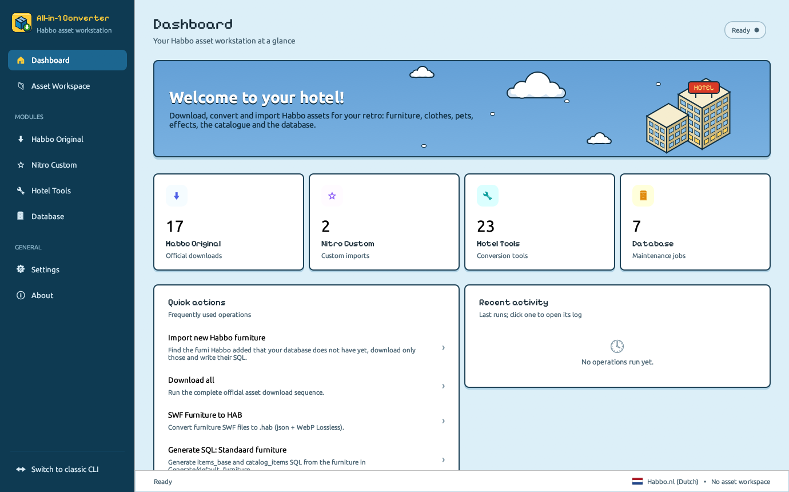
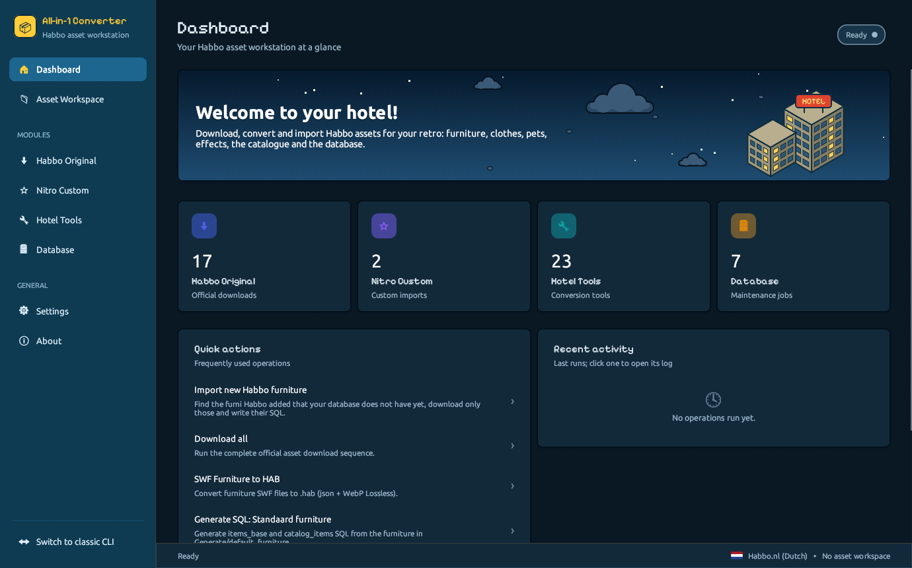
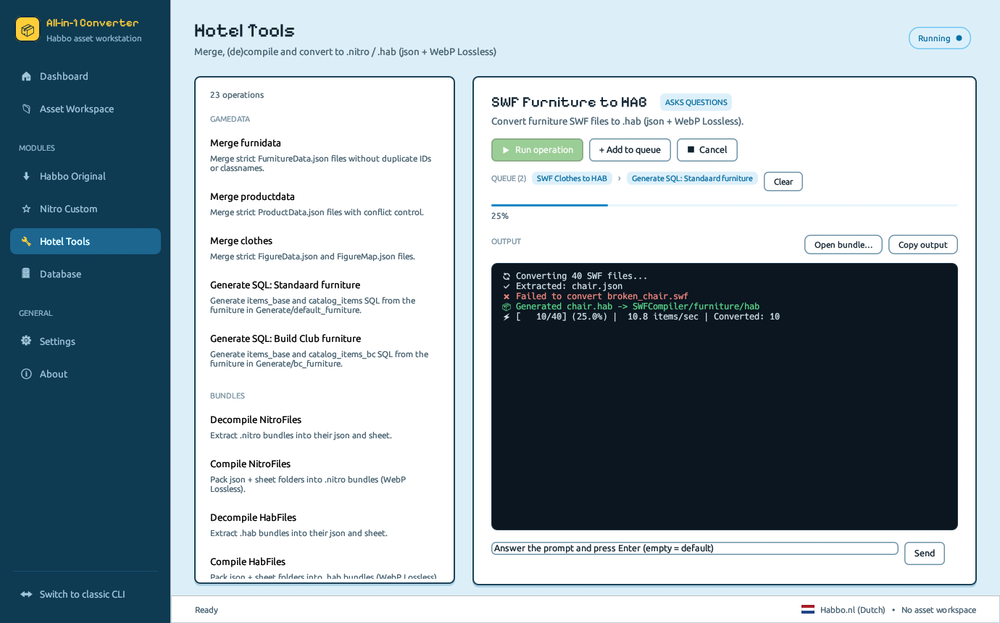
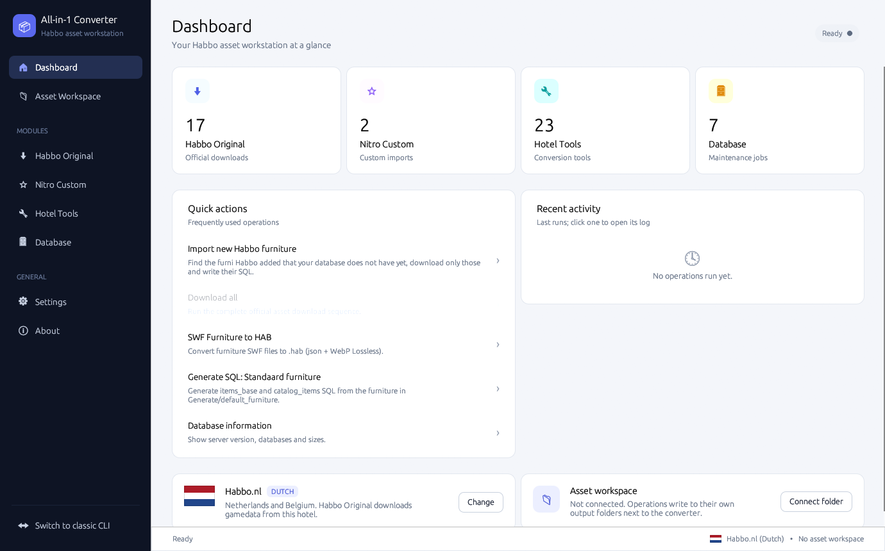
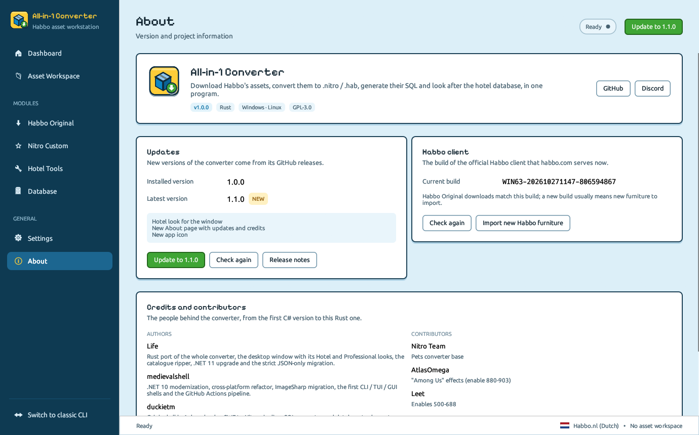

# All-in-1 Converter

A Habbo asset workstation that bundles every step of a hotel pipeline behind a single binary:
download Habbo's official assets, import custom Nitro packs, merge furnidata / clothesdata /
productdata, convert SWF → `.nitro` / `.hab`, generate the SQL inserts for `items_base` +
`catalog_items`, and fix the database in place.

Written in Rust. One self-contained exe for Windows and Linux (~35 MB, FFDec included), with a
desktop window and a keyboard-only console mode behind the same operations.

## At a glance

| | |
|---|---|
| Language | Rust (stable), Windows x64 and Linux x64 |
| Desktop window | egui, Hotel and Professional looks, light/dark theme, 9 languages |
| Sprite sheets | lossless WebP (libwebp) or PNG, pixel-checked |
| Database | MariaDB / MySQL (mysql_async), automatic backups before changes |
| SWF reader | built in; JPEXS FFDec (`assets/ffdec`, embedded) only as a fallback |
| Data formats | strict single-file JSON |

## Download and run

Get `habbo-downloader-windows-x64.exe` (or `-linux-x64`) from the
[releases](https://github.com/SimoLeoLife/all-in-1-converter/releases) and put it in the folder
you want to work in. On first launch it writes `config.ini` and unpacks FFDec into `Tools/`.

```text
habbo-downloader                     # double-click: start window; terminal: asks Professional or CLI
habbo-downloader --professional      # the desktop window
habbo-downloader --cli               # mainframe-style console menus (keyboard only, SSH friendly)
habbo-downloader --op <id>           # run one operation, e.g. tools.swf-furniture-hab
habbo-downloader --benchmark         # PNG vs lossless WebP sheets on a sample of your furni
habbo-downloader --help
```

The app checks GitHub for a newer release at start (and from *Check for updates*) and installs
it in place.

## The window



- **Two looks** (Settings → *Look*, or `look=` in `config.ini`): **Hotel**, the default, with the
  hotel's blues, outlined cards, green go buttons, pixel titles and a hotel view on the dashboard
  (blue sky by day, stars by night); **Professional**, neutral and compact.
- **Dashboard** with the modules, quick actions, recent runs (logs kept in `logs/`), your hotel and
  asset workspace.
- **Operation pages** with live, coloured output, an answer box for the operation's questions, a
  real progress bar, **Cancel** and a **queue** (*Add to queue*: runs go one after another).
- **Drag and drop**: drop `.swf` files to convert them, or a `.nitro` / `.hab` to look inside it
  (sheet + json); also *Open bundle…*.
- **About** shows the installed and latest version with *Update* (the update is downloaded and swapped
  in place), the build of the Habbo client habbo.com serves now, and the credits.
- **Settings** edits `config.ini`: language, Habbo hotel, download and sheet format, Nitro retro
  URLs, database (with *Test connection*).
- **Languages**: English, Italiano, Français, Deutsch, Nederlands, Español, Português (Brasil),
  Türkçe, Suomi. Operation output and the console mode stay in English.

| Hotel, dark | Operation page | Professional |
|---|---|---|
|  |  |  |



Screenshots are made by the app itself: `HABBO_SCREENSHOT=<file.png>` with
`HABBO_SCREENSHOT_PAGE`, `HABBO_SCREENSHOT_THEME=light|dark`, `HABBO_SCREENSHOT_LOOK=hotel|professional`
and `HABBO_SCREENSHOT_LANG`.

## Operations

1. **Habbo Original** — badges, clothes, effects, furnidata, furniture (`.swf` and/or `.hab`),
   icons, MP3, productdata, quests, reception, texts, variables, pets, effect icons, *Download
   all*, **Import new Habbo furniture** (compares the current furnidata with your `items_base`,
   downloads only the new furni and writes their SQL; the database itself is not changed) and
   **Rip Habbo catalogue (G-Earth)**: with G-Earth connected to your own Habbo client, saves the
   whole catalogue — page tree, layouts, texts, images, offers, prices — as `catalog.json`,
   Arcturus `catalog_pages.sql` / `catalog_items.sql` and the page images in `Catalog/<hotel>_<date>/`.
2. **Nitro Custom** — furniture and clothes from a Nitro retro (`renderer-config.json` URLs).
3. **Hotel Tools** — merge furnidata / productdata / clothes, generate SQL (standard and Builders
   Club), compile / decompile `.nitro` and `.hab`, SWF → `.nitro` / `.hab` for furniture, clothes,
   pets and effects, Nitro → HAB, add size 32 to Habbo's `.hab` furni, decompile SWF.
4. **Database** — server info, optimize, fix offer IDs, sit / lay / walk, sprite and item IDs,
   interaction counts and sizes. The tools that change tables first save them to
   `Database/Backups/<operation>_<date>.sql`.

Every console menu has a `?` entry explaining its items.

## SQL generator workflow

1. Put `.nitro` / `.hab` / `.swf` files in `Generate/default_furniture/` (or `bc_furniture/`).
2. Put `FurnitureData.json` in `Generate/Furnidata/`.
3. Run *Generate SQL*. Width / length / height / interactions are read from each bundle; it asks
   for the starting ID and the catalog page ID.
4. The SQL is written to `Generate/Output_SQL/` with a timestamp.

## Runtime layout

Created next to the exe on first run:

```
config.ini              settings (missing keys fall back to the defaults)
Tools/ffdec/            FFDec, unpacked from the exe
Habbo_Default/          downloaded official Habbo assets
Merge/                  Original_ / Import_ / Merged_ for furnidata, productdata, clothes
Generate/               Furnidata/, default_furniture/, bc_furniture/, Output_SQL/
NitroCompiler/          compile/, compiled/, extract/, extracted/
SWFCompiler/            import/, plus output folders per asset class
Database/               Variables/ (FurnitureData.json for the fix tools), Backups/
custom_downloads/       Nitro retro downloads
logs/                   run history and one log per run
Catalog/                catalogue rips (G-Earth)
```

## Repository

```
crates/core        console, config.ini, settings, paths, HTTP, FFDec, JSON, images, .NET-compatible formatting
crates/swf         built-in SWF reader and decompiler
crates/nitro       .nitro / .hab bundles, WebP sheets, bundle tools
crates/furni       SWF furniture and pets → bundles
crates/figure      SWF clothes and effects → bundles
crates/downloads   Habbo and Nitro downloaders (parallel, resumable)
crates/db          database tools, SQL generator, backups
crates/tools       merge tools
crates/pipeline    multi-step workflows (Import new Habbo furniture)
crates/catalog     G-Earth extension client and catalogue ripper
crates/app         the exe: operation catalogue, console menus, egui window, translations
crates/golden      golden tests  →  fixtures in tests/golden/
assets/ffdec       JPEXS FFDec, embedded into the exe at build time
examples/merge     sample furnidata / productdata / clothes files for the merge tools
Addons/            custom effects, artwork, hotel backgrounds
docs/              CONTRIBUTING.md, history of the port
scripts/           publish-win.bat, publish-linux.sh
```

## Build

```bash
cargo build --release          # target/release/habbo-downloader(.exe)
cargo test --workspace         # unit tests + golden tests on real Habbo files
scripts/publish-win.bat        # or scripts/publish-linux.sh → publish/<os>-x64/
```

Prerequisites: Rust stable. On Windows with the GNU toolchain, MinGW-w64 on `PATH`
(`scoop install rustup-gnu mingw`); MSVC works too. On Linux: `pkg-config libssl-dev
libxkbcommon-dev libgl1-mesa-dev`. Java is optional (only the FFDec fallback uses it).

## Releases

Bump `version` in `Cargo.toml`, then push a matching tag; the *Release* workflow tests, builds
both binaries and publishes them, and the app's update check finds them:

```bash
git tag rust-v1.1.0 && git push origin rust-v1.1.0
```

*CI* runs the tests and builds on Windows and Linux for every pull request and push to `main`.

## Custom effects

Drop-in custom effects live in `Addons/Custom Effects/` — read the README there for the file
naming convention. The Among Us pack and the Leet pack are included as references.

## History

This project started as a C# / .NET tool. It was ported to Rust and checked against the C# build
on real Habbo files — json byte for byte, sheets pixel for pixel, SQL and gamedata byte for byte,
database tools row for row — before the C# code was removed. The golden tests keep that output
fixed. See [docs/RUST_PORT.md](docs/RUST_PORT.md).

## Credits

- **Life** — Rust port, .NET 11 upgrade, strict JSON-only migration, Professional dashboard.
- **Lorenzune** — WebP Lossless sprite sheets for every SWF → Nitro / HAB conversion (furniture,
  clothes, pets, effects), the SWF decompiler, the per-run conversion and compression report, and
  the `--benchmark` suite (compression ratio + pixel fidelity).
- **medievalshell** — .NET 10 modernization, cross-platform refactor, ImageSharp migration, the
  CLI / TUI / GUI shells, Mainframe + Matrix themes, GitHub Actions pipeline.
- **duckietm** — original all-in-1 downloader, SWF → Nitro pipeline, SQL generator, database
  tools, upstream maintainer.
- **Nitro Team** — pets converter base (`discord.gg/yCXcMqrT`).
- **AtlasOmega** — "Among Us" effects (enable 880-903).
- **Leet** — enables 500-688.
- The Hotel look follows duckietm's [All-in-1 Installer](https://github.com/duckietm/All-in-1-installer).
  Fonts: Ubuntu (Ubuntu Font Licence 1.0) and Pixelify Sans (SIL Open Font Licence 1.1), licences
  in `crates/app/assets/fonts`.
- The whole Habbo retro community.

Licence: GPL-3.0 (see `LICENSE`).

## Want to help?

Discord: https://discord.gg/txfNucJv

Everything here is free — don't get scammed.
